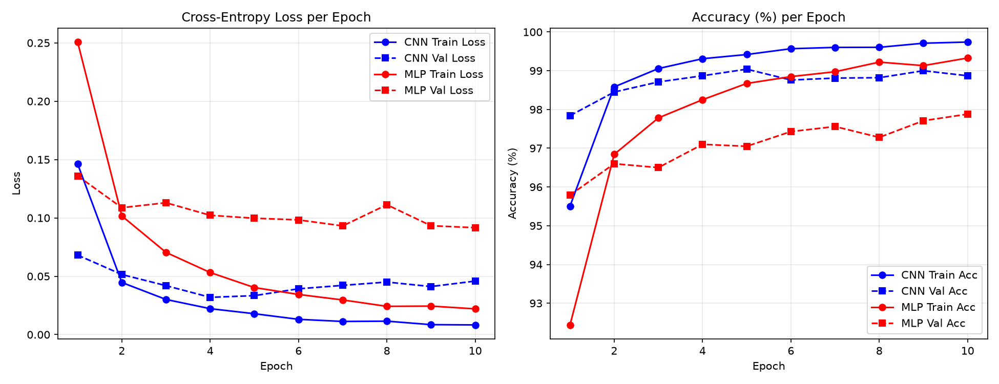
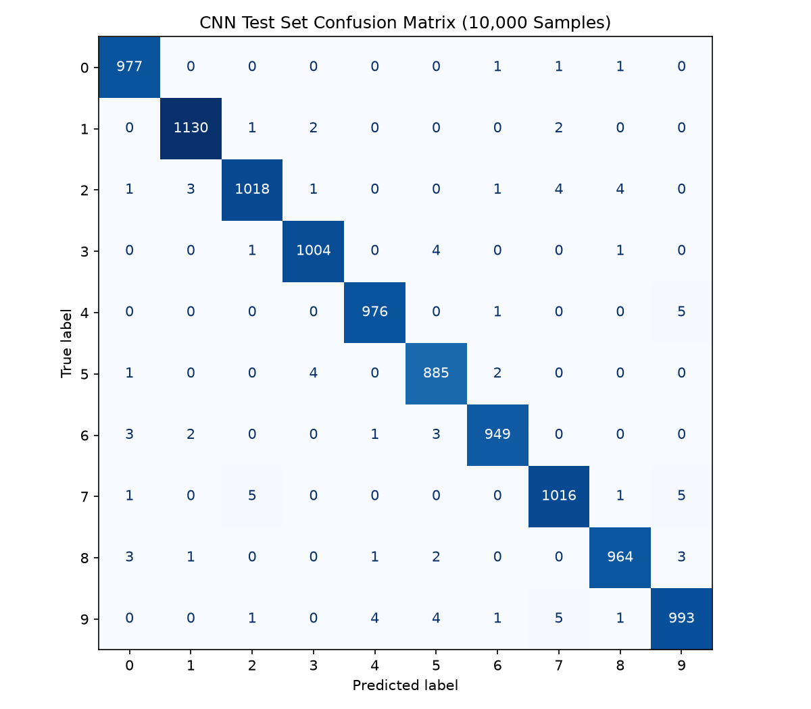
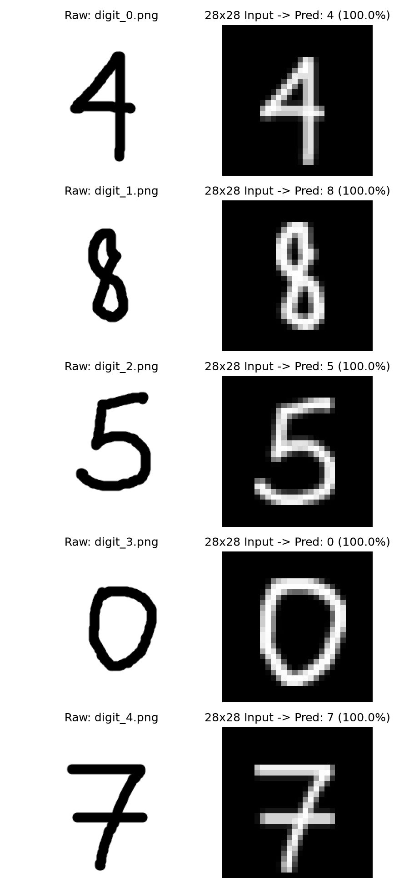
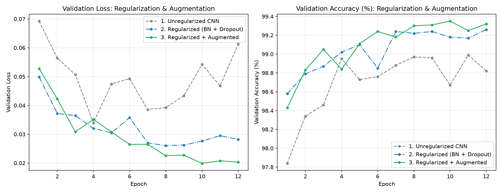
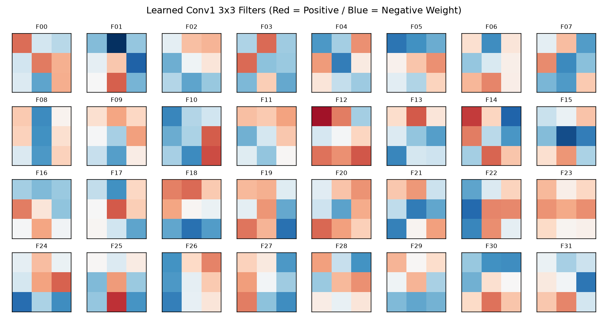
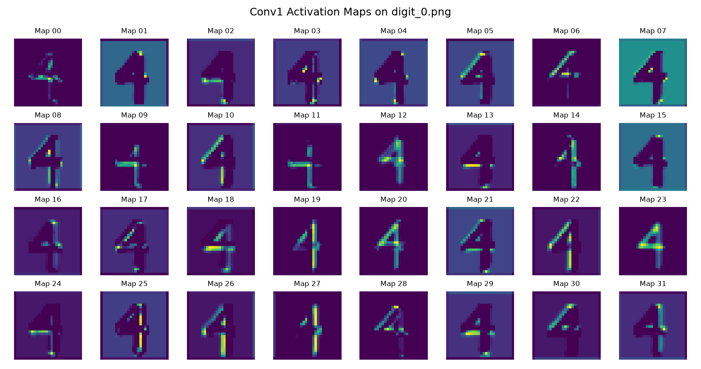

# Handwritten Digit Classifier with a CNN (MNIST)

A from-scratch Convolutional Neural Network built in **PyTorch** to classify handwritten digits (`0–9`), benchmarked against a plain Multi-Layer Perceptron (MLP) baseline under identical conditions and evaluated on real-world handwritten digits outside the MNIST dataset.

---

## Framework & Anti-Cheat Compliance
* **Framework:** PyTorch (`torch`, `torchvision`)
* **Initialization:** All models are trained strictly from **random weight initialization**—no pretrained weights or transfer learning backbones are used.

---

## Project Structure
```text
mnist-cnn-classifier/
├── custom_digits/               # 5 real handwritten digit images tested in inference
├── models/                      # Saved PyTorch model checkpoints (.pth)
├── outputs/                     # Generated curves, confusion matrix & filter plots
├── src/
│   ├── data.py                  # Explicit 50k/10k/10k split & MNIST standardization
│   ├── models.py                # DigitCNN, DigitMLP, and RegularizedDigitCNN
│   ├── train.py                 # Training loop, baseline comparison & confusion matrix
│   ├── predict_custom.py        # Standalone weight reload & real-world inference
│   ├── bonus_experiments.py     # BatchNorm/Dropout + Data Augmentation ablation
│   ├── visualize_filters.py     # Conv1 3x3 kernel & activation map visualizations
│   └── api.py                   # FastAPI REST inference endpoint
├── requirements.txt
└── README.md
```

---

## 1. Data Pipeline
* **Dataset:** Official MNIST handwritten digits (`28×28` grayscale, 70,000 total images).
* **Explicit Train / Validation / Test Split:** The 60,000 official training images are deterministically split (`seed=42`) into **50,000 training** and **10,000 validation** samples. The **10,000 test** samples remain isolated until final evaluation.
* **Normalization:** Pixel values are scaled from `[0, 255]` to `[0.0, 1.0]` via `ToTensor()` and standardized using MNIST's training-set statistics (`mean = 0.1307`, `std = 0.3081`).

---

## 2. CNN Architecture (Layer-by-Layer)
`DigitCNN` consists of two `Conv2d -> ReLU -> MaxPool2d` blocks followed by a two-layer dense classification head:

| Layer | Operation | Input Shape | Output Shape | Trainable Params |
| :--- | :--- | :--- | :--- | ---: |
| `conv_block1[0]` | `Conv2d(1, 32, kernel_size=3, padding=1)` | `(B, 1, 28, 28)` | `(B, 32, 28, 28)` | 320 |
| `conv_block1[1]` | `ReLU()` | `(B, 32, 28, 28)` | `(B, 32, 28, 28)` | 0 |
| `conv_block1[2]` | `MaxPool2d(kernel_size=2, stride=2)` | `(B, 32, 28, 28)` | `(B, 32, 14, 14)` | 0 |
| `conv_block2[0]` | `Conv2d(32, 64, kernel_size=3, padding=1)` | `(B, 32, 14, 14)` | `(B, 64, 14, 14)` | 18,496 |
| `conv_block2[1]` | `ReLU()` | `(B, 64, 14, 14)` | `(B, 64, 14, 14)` | 0 |
| `conv_block2[2]` | `MaxPool2d(kernel_size=2, stride=2)` | `(B, 64, 14, 14)` | `(B, 64, 7, 7)` | 0 |
| `classifier[0]` | `Flatten()` | `(B, 64, 7, 7)` | `(B, 3136)` | 0 |
| `classifier[1]` | `Linear(3136, 128)` + `ReLU()` | `(B, 3136)` | `(B, 128)` | 401,536 |
| `classifier[3]` | `Linear(128, 10)` | `(B, 128)` | `(B, 10)` | 1,290 |
| **Total** | | | | **421,642** |

---

## 3. CNN vs. MLP Baseline Comparison
Both models were trained for **10 epochs** using **Adam (`lr=1e-3`)**, batch size **64**, and Cross-Entropy loss on the identical `50k / 10k / 10k` split (`seed=42`). Best validation checkpoints were evaluated on the held-out test set:

| Model | Architecture | Best Val Accuracy | Test Accuracy | Test Loss | Test Errors (out of 10,000) |
| :--- | :--- | ---: | ---: | ---: | ---: |
| **DigitMLP (Baseline)** | `784 -> 256 -> 128 -> 10` | 97.88% | 97.97% | 0.0787 | 203 |
| **DigitCNN** | 2× Conv+Pool + Dense Head | **99.04%** | **99.12%** | **0.0258** | **88** |

By Epoch 1, `DigitCNN` reaches `97.84%` validation accuracy—matching what takes the MLP all 10 epochs to achieve—and reduces total test-set errors by **56.7%** through local spatial feature sharing and translation invariance.



---

## 4. Confusion Matrix & Error Analysis


### Most-Confused Digit Pair & Hypothesis
* **Most-Confused Pair:** **7 and 9** (10 bidirectional errors: 5 instances of true `7` predicted as `9`, and 5 instances of true `9` predicted as `7`), tied for single-direction errors with `7 → 2` (5 errors) and `4 → 9` (5 errors).
* **Hypothesis:** In casual handwriting, a `9` whose upper loop is left slightly open or narrowly closed closely resembles a `7` written with a curved top bar. Conversely, a `7` written with a horizontal crossbar or curved downstroke shares strong structural overlap with `9` and `2` once downsampled to a `28×28` pixel grid.

---

## 5. Model Persistence & Real-World Handwritten Inference
Trained checkpoints are saved to `models/cnn_mnist.pth` and reloaded in a standalone script (`src/predict_custom.py`) without retraining. Each real-world image undergoes explicit preprocessing to match MNIST's distribution:
1. Convert to single-channel grayscale (`L`).
2. Detect background polarity and invert if drawn/photographed with dark ink on a light background (matching MNIST's white-on-black format) and threshold faint background noise.
3. Crop a tight bounding box around the digit and resize the longest side to `20 px` while preserving aspect ratio.
4. Pad into a `28×28` canvas and shift by **center-of-mass**.
5. Scale to `[0, 1]` and standardize with `mean=0.1307`, `std=0.3081`.

| Image File | True Digit | Predicted Digit | Confidence |
| :--- | :---: | :---: | ---: |
| `digit_0.png` | 4 | **4** | 100.0% |
| `digit_1.png` | 8 | **8** | 100.0% |
| `digit_2.png` | 5 | **5** | 100.0% |
| `digit_3.png` | 0 | **0** | 100.0% |
| `digit_4.png` | 7 | **7** | 100.0% |



---

## 6. Bonus Features

### A. Regularization (`BatchNorm` + `Dropout`) & Data Augmentation Ablation
To mitigate the mild overfitting observed after Epoch 5 in the base CNN, `RegularizedDigitCNN` adds `BatchNorm2d`/`BatchNorm1d` and spatial/dense `Dropout`, and is trained with `RandomAffine` (`±12°` rotation, `±10%` translation, `0.92–1.08×` scale) applied strictly to the training split over 12 epochs:

| Model Variant | Best Val Accuracy | Test Accuracy | Test Errors (out of 10,000) |
| :--- | ---: | ---: | ---: |
| 1. Unregularized CNN | 98.99% | 99.02% | 98 |
| 2. Regularized CNN (`BatchNorm` + `Dropout`) | 99.26% | 99.21% | 79 |
| 3. Regularized CNN + Data Augmentation | **99.35%** | **99.43%** | **57** |



### B. Learned `Conv1` Filters & Activation Maps
Visualizing the 32 learned `3×3` kernels in `conv_block1[0]` confirms the CNN learned oriented edge detectors from random initialization (e.g., vertical stroke detectors `F08`/`F10`, horizontal detector `F18`, and diagonal detectors `F00`/`F14`), which decompose handwritten digits into horizontal crossbars and vertical stems:




### C. FastAPI Inference Endpoint
`src/api.py` serves the trained model over HTTP with interactive Swagger documentation at `/docs`:
* `GET /health` — Returns active model weights and compute device.
* `POST /predict` — Accepts an uploaded image file (`multipart/form-data`) and returns the predicted digit, confidence score, and full 10-class probability distribution:

```json
{
  "filename": "digit_4.png",
  "predicted_digit": 7,
  "confidence": 1,
  "probabilities": {
    "0": 0, "1": 0, "2": 0, "3": 0, "4": 0,
    "5": 0, "6": 0, "7": 1, "8": 0, "9": 0
  }
}
```

---

## How to Run
```bash
# 1. Install dependencies
pip install -r requirements.txt

# 2. Train CNN & MLP baseline, generate learning curves & confusion matrix
python src/train.py

# 3. Reload saved weights and run inference on custom_digits/
python src/predict_custom.py

# 4. Run regularization + data augmentation ablation & filter visualizations
python src/bonus_experiments.py
python src/visualize_filters.py

# 5. Launch the FastAPI inference server (open [http://127.0.0.1:8000/docs](http://127.0.0.1:8000/docs))
uvicorn src.api:app --reload
```